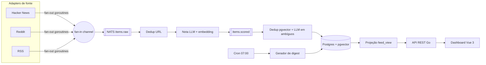

# PLANO — Horizon-Go ("Radar by JpDev")

Reescrita em Go + Vue 3 do [Thysrael/Horizon](https://github.com/Thysrael/Horizon) (MIT, Python). Só análise e plano.

## 1. O que o original faz (lido no código)
- **Fontes** (`src/scrapers/`): hackernews, reddit, rss, github, telegram, twitter (+playwright), gdelt, google_news, openbb, ossinsight.
- **Pipeline** (`src/orchestrator.py::run`): janela de tempo → fetch paralelo (`asyncio.gather`) → merge por URL normalizada (`merge_cross_source_duplicates`) → nota LLM 0–10 por profile (`src/ai/analyzer.py`, `src/ai/prompting/analysis.py`, `profiles/*/analysis.md`; JSON score/reason/summary/tags) → threshold por profile + cotas por categoria (`apply_balanced_digest`) → dedup por tema via LLM → enrichment com `web_search`/`history_search` (`src/ai/enricher.py`, `src/processing/tools.py`) → digest por idioma.
- **Dedup de tema** (`merge_topic_duplicates`, `src/ai/prompting/deduplication.py`): um único prompt com título+tags+resumo de todos os itens; sem embeddings; se falhar, pula.
- **LLMs** (`src/models.py`): anthropic, openai, openai-chatgpt, azure, ali, gemini, doubao, minimax, deepseek, ollama. Exemplo: `gpt-4`, temp 0.3.
- **Digest** (`src/ai/summarizer.py`): Markdown renderizado por código → `data/summaries`, `docs/_posts` (Jekyll/GitHub Pages), e-mail, webhook, WeChat.
- **Config**: `data/config.json` + `.env`; profiles em `profiles/`.
- **UI**: sem dashboard; site Jekyll, servidor MCP (`src/mcp`), wizard CLI (`src/setup/wizard.py`).
- **Pontos fracos**: dedup não escala (1 prompt com tudo) e sem vetores; persistência em arquivos; `run()` monolítico e sequencial; concorrência padrão 1.

## 2. Nome
**Horizon-Go** (repo) / marca **Radar by JpDev**.

## 3. Arquitetura (hexagonal)
- `domain/`: Item, Score, Cluster, Digest. `ports/`: `Source`, `LLM`, `Embedder`, `ItemRepo`, `EventBus`, `FeedQuery`.
- `adapters/`: `source/hn`, `source/reddit`, `source/rss`; `llm/openai` (compatível com Ollama); `store/postgres`; `bus/nats`; `http/` (chi).
- **Pipeline concorrente**: fan-out de uma goroutine por fonte (`errgroup` + `context`), fan-in num channel; workers com pool limitado para nota/embedding.
- **Fila**: NATS JetStream — `items.raw` → `items.scored` → `items.deduped` (Redis Streams como alternativa).
- **CQRS**: comandos gravam em `items`/`clusters`; projeção `feed_view` (read model) atualizada por consumer; API de leitura só lê a projeção.
- **Cron**: `robfig/cron` às 07:00 (America/Sao_Paulo) gera o digest e publica `digest.ready`.

## 4. Stack
Go 1.23, chi, pgx, sqlc, goose, NATS JetStream, Postgres 16 + pgvector, Docker Compose. Vue 3 + Vite + TypeScript, Pinia, Vue Router, TailwindCSS.

## 5. Escopo do MVP
- 3 fontes: HN, Reddit, RSS.
- Nota LLM 0–10 com rubrica (inspirada nos profiles do original) + embeddings.
- Dedup: URL normalizada → cosseno pgvector > 0,88 = duplicado; 0,80–0,88 = LLM decide.
- Digest diário em Markdown/HTML + dashboard Vue.

## 6. Telas Vue
1. **Feed** — cards por nota, filtros fonte/tag/período, busca.
2. **Detalhe/Cluster** — item principal + duplicados agrupados, motivo da nota.
3. **Digests** — lista por data e leitura.
4. **Fontes & Config** — ligar/desligar fontes, subreddits, feeds RSS, threshold.
5. **Métricas** — itens/dia, custo de tokens, taxa de dedup, falhas por fonte.

**Visual JpDev**: fundo preto (#0B0B0B), amarelo primário (#FFD400) em CTAs, notas e destaques; laranja (#FF7A00) só em badges e alertas. Inspiração nos dashboards mais bem ranqueados do Dribbble: bento grid, cards com borda fina, tipografia forte (Inter/Space Grotesk), dark mode nativo, microanimações.

## 7. Fases
| Fase | Entrega | Estimativa |
|---|---|---|
| 0 | Monorepo, Docker Compose, CI, migrations | 2 dias |
| 1 | Ports + adapters HN/Reddit/RSS, fan-out/fan-in, NATS | 4 dias |
| 2 | Nota LLM + embeddings + dedup pgvector | 4 dias |
| 3 | CQRS feed_view + API + cron do digest | 2 dias |
| 4 | Dashboard Vue (5 telas) | 5 dias |
| 5 | Deploy, README, demo pública | 2 dias |
| | **Total** | **~19 dias (~3–4 semanas)** |

## 8. Riscos
- Custo/latência de LLM → batch, cache por hash de URL, modelo barato, opção Ollama.
- Rate limit da API do Reddit e mudanças de política.
- Calibrar limiar de similaridade (falsos positivos/negativos).
- Prompt injection vindo do conteúdo (o original já trata como input não confiável).
- Escopo crescer além do MVP.

## 9. O que vai além do original
Dedup por embeddings (escala), Postgres em vez de arquivos, dashboard web, API REST, pipeline orientado a eventos, observabilidade (OpenTelemetry/Prometheus), concorrência real por padrão.

## 10. Crédito e licença
Licença MIT mantida. README e NOTICE citam: "Baseado em [Horizon](https://github.com/Thysrael/Horizon) © 2026 Thysrael, MIT." Prompts/rubricas adaptados ficam com atribuição.
