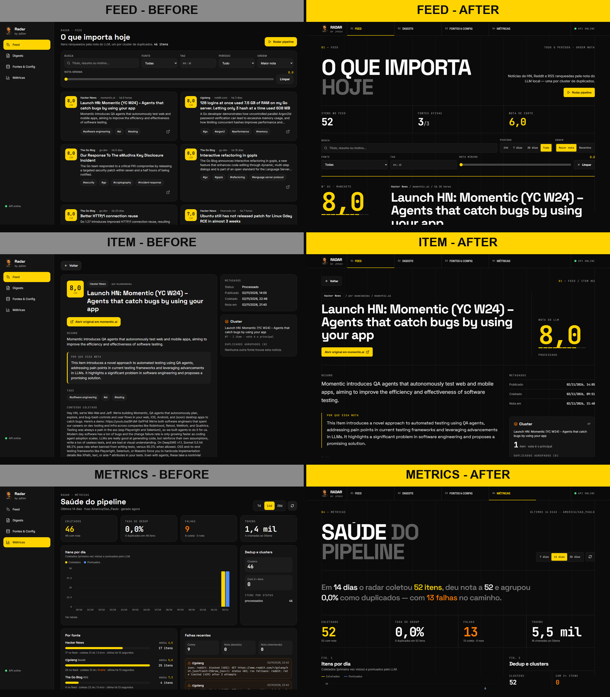
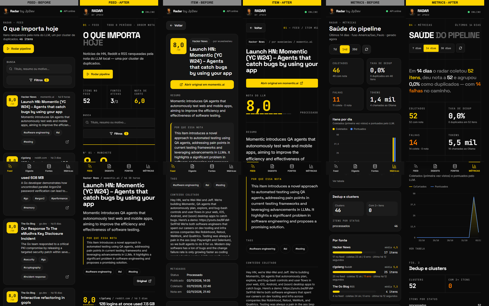
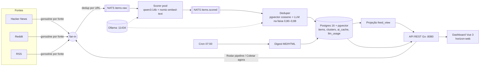

# Horizon-Go — Radar by JpDev

Agregador de notícias tech que coleta Hacker News, Reddit e feeds RSS, dá uma nota de 0 a 10
a cada item com um LLM local (Ollama), agrupa duplicados por similaridade de embeddings
(pgvector) e gera um digest diário em Markdown/HTML, tudo visível num dashboard Vue 3.

É uma reescrita em **Go + Vue 3** do [Horizon](https://github.com/Thysrael/Horizon), de
Thysrael (Python, MIT). O plano e a análise do original estão em [`PLANO.md`](PLANO.md).

> **Este repositório é só o backend em Go** (API, worker, migrations). O dashboard Vue 3 fica em
> **[horizon-web](https://github.com/Joao-Pedro-AI-Visionary/horizon-web)**, separado deste repo com o histórico preservado.

| Feed | Detalhe/Cluster | Métricas |
|---|---|---|
|  |  |  |

## Antes / Depois

Primeira versão do dashboard (esquerda) e a versão atual, após o redesign editorial e os widgets
da segunda referência (direita). Feed, detalhe do item e métricas; decisões em
[`docs/DESIGN.md`](docs/DESIGN.md). As capturas originais ficam em
[`docs/screenshots/before/`](docs/screenshots/before/).

**Desktop (1440x900)**



**Mobile (390x844)**



## O que ele faz

- **Coleta concorrente**: uma goroutine por fonte (`errgroup` + `context`), fan-in num channel,
  dedup por URL normalizada e publicação em `items.raw` no NATS JetStream.
- **Nota por LLM**: `qwen3:14b` via Ollama (JSON, `think: false`) com rubrica inspirada nos
  profiles do original; nota, motivo, resumo e tags. Cache por hash de conteúdo e contagem de tokens.
- **Dedup semântico**: embeddings `nomic-embed-text` (768 dims) em pgvector com índice HNSW.
  Cosseno > 0,88 é duplicado direto; entre 0,80 e 0,88 o LLM decide; abaixo disso é item novo.
- **CQRS**: comandos gravam em `items`/`clusters`; a projeção `feed_view` é o read model da API.
- **Digest diário**: cron (`robfig/cron`) às 07:00 America/Sao_Paulo, seleção por nota de corte,
  máximo de itens e cota por fonte, renderizado em Markdown e HTML.
- **Dashboard** ([horizon-web](https://github.com/Joao-Pedro-AI-Visionary/horizon-web)): Feed, Detalhe/Cluster, Digests, Fontes & Config e
  Métricas, em desktop, tablet e mobile. Toda ação chama esta API; não há mock no front.

## Arquitetura

Hexagonal: `domain` (entidades), `ports` (interfaces) e `adapters` (fontes, LLM, Postgres,
NATS, HTTP). Dois binários: `cmd/api` (REST, chi) e `cmd/worker` (coleta, nota, dedup, cron).



### Estrutura

```
backend/                 módulo Go github.com/jpdev/horizon-go
  cmd/api                API REST (feed, itens, digests, fontes, settings, métricas, pipeline)
  cmd/worker             coleta contínua, scorer, deduper e cron do digest (--once, --seed)
  cmd/migrate            migrations goose embutidas (up|down|status)
  internal/domain        Item, Score, Cluster, Digest, limiares
  internal/ports         Source, LLM, Embedder, ItemRepo, EventBus, FeedQuery
  internal/adapters      source (hn, reddit, rss), llm (ollama), store/postgres, bus/natsbus, httpapi
  internal/app|ingest|enrich|digest|retry   casos de uso e estágios do pipeline
  migrations/            extensions, core tables, feed_view, ingestion, ai stages, api/digest
scripts/*.ps1            migrate, dev, test, start-local, stop-local (Windows / PowerShell)
docker-compose.yml       Postgres pgvector pg16 + NATS JetStream
docs/                    DESIGN.md e screenshots do dashboard
```

O front (Vue 3 + Vite + TS + Pinia + Vue Router + Tailwind v4, e2e Playwright, tour narrado) está em
[horizon-web](https://github.com/Joao-Pedro-AI-Visionary/horizon-web).

### API

| Método e rota | O que faz |
|---|---|
| `GET /healthz` | saúde (Postgres e NATS) |
| `GET /api/feed` | feed paginado (`source_id`, `tag`, `q`, `period` ou `from`/`to`, `min_score`, `sort`, `page`) |
| `GET /api/feed/timeline` | itens do feed por dia nos últimos `days` (1–90, padrão 30), mesmos filtros não-temporais; alimenta o scrubber de datas |
| `GET /api/items/{id}` | item, cluster e duplicados com similaridade |
| `GET /api/digests` · `GET /api/digests/{date}` · `POST /api/digests/generate` | digests (`format=html\|md`) |
| `GET/POST /api/sources` · `PATCH/DELETE /api/sources/{id}` · `POST /api/sources/{id}/fetch` | CRUD de fontes e coleta manual |
| `GET/PUT /api/settings` | nota de corte, máximo de itens, cota por fonte, cron e fuso do digest |
| `GET /api/metrics?days=7\|14\|30` | itens/dia, por fonte, dedup, falhas e tokens |
| `POST /api/pipeline/run` | coleta todas as fontes ativas e publica no NATS |

## Como rodar no Windows (Docker no WSL)

Requisitos: Go 1.26+ (o `go.mod` pede 1.26), Docker dentro do WSL e Ollama no Windows. Para o
dashboard: Node 24 e um clone do [horizon-web](https://github.com/Joao-Pedro-AI-Visionary/horizon-web).

```powershell
# 1. Infra no WSL: Postgres+pgvector em :5450 e NATS JetStream em :4230 (monitor :8230)
wsl docker compose up -d

# 2. Modelos locais
ollama pull qwen3:14b
ollama pull nomic-embed-text

# 3. Banco
.\scripts\migrate.ps1 up

# 4. Backend (dois terminais, na pasta backend)
go run ./cmd/worker --seed     # insere HN, r/golang e Go blog e fica em modo contínuo
go run ./cmd/api               # :8080
# ou, tudo em segundo plano: .\scripts\start-local.ps1 (containers + migrate + api + worker;
# checa http://localhost:8080/healthz) e .\scripts\stop-local.ps1 para parar

# 5. Front (no clone do horizon-web)
npm ci; npm run dev            # Vite em http://localhost:5173 (proxy de /api para :8080)
```

O WSL repassa as portas publicadas para `localhost` do Windows, então o Postgres do container
de dev (usuário/senha/banco `horizon`, porta 5450; ver `.env.example`) e `nats://localhost:4230`
funcionam sem configuração. Variáveis: `DATABASE_URL` (ou `PGUSER`/`PGPASSWORD`/`PGHOST`/`PGPORT`/`PGDATABASE`), `NATS_URL`, `API_ADDR`, `HORIZON_CORS_ORIGINS`,
`OLLAMA_URL`, `LLM_MODEL`, `EMBED_MODEL`, `LLM_NUM_CTX`, `SCORE_WORKERS`.

**CORS**: o front roda em outra origem. Com o proxy do Vite (padrão do horizon-web) nada muda; se o
navegador chamar a API direto (`VITE_API_URL` no horizon-web), libere a origem do front em
`HORIZON_CORS_ORIGINS` (lista separada por vírgula; `CORS_ORIGINS` ainda é aceito). Padrão:
`http://localhost:5173,http://localhost:4173,http://127.0.0.1:5173,http://127.0.0.1:4173`.

## Como rodar via docker-compose (Linux/macOS)

```bash
docker compose up -d           # pgvector/pgvector:pg16 + nats:2.10 -js, mesmas portas
make migrate
cd backend && go run ./cmd/worker --seed &   # worker em segundo plano
make dev                       # API em :8080 (o front fica no horizon-web: npm run dev)
docker compose down            # para; o volume pgdata é preservado
```

O compose sobe só a infra; API e worker rodam no host (o Vite roda no clone do horizon-web). O Ollama também fica no host
(`http://localhost:11434`).

## Deploy grátis (Render + Neon + Groq + Cloudflare)

O backend inteiro (API, worker e NATS JetStream) roda num **único container**
no plano free do Render. O banco é Postgres com pgvector no Neon free, a
pontuação usa o Groq (`openai/gpt-oss-20b`) e os embeddings usam o Cloudflare
Workers AI (`@cf/baai/bge-base-en-v1.5`, 768 dims, mesmo tamanho da coluna
atual). O front vai pra Vercel.

- `Dockerfile` + `deploy/nats.conf`: imagem distroless. O `cmd/supervise` sobe
  o nats-server, roda as migrations, sobe o worker e a API e derruba o
  container se algum processo morrer.
- `render.yaml`: Blueprint com health check `/healthz` e segredos
  `sync: false`.
- `.env.production.example`: todas as variáveis de produção.
- `docs/deploy.md`: passo a passo (Neon, Groq, Cloudflare, Render, Vercel),
  limites grátis verificados e como coletar com o serviço dormindo.

Os provedores são escolhidos por env: `LLM_PROVIDER=ollama|groq|openai` e
`EMBED_PROVIDER=ollama|cloudflare|none`. Sem nada definido, tudo continua no
Ollama local.

## Testes

```powershell
.\scripts\test.ps1             # go build + go vet + go test
cd backend; go test ./... -count=1 -cover
```

- **Go**: testes de unidade e de integração contra Postgres e NATS reais. A integração usa um
  banco próprio (criado e migrado pelo teste) e é pulada com `HORIZON_SKIP_INTEGRATION=1`.
- **E2E (Playwright) e vídeos**: ficam no [horizon-web](https://github.com/Joao-Pedro-AI-Visionary/horizon-web) e rodam contra esta API
  (`HORIZON_API_URL`, padrão `http://localhost:8080`): 5 telas e todas as ações em desktop
  1440x900, tablet 834x1112 e mobile 390x844, vídeos `videos/e2e-<project>.mp4`, tour
  `videos/demo-final.mp4` e o vídeo narrado em pt-BR.

## Referências do Dribbble

Escolhidas pelos títulos e descrições na busca do Dribbble; o que foi aproveitado de cada uma:

| Referência | O que foi aproveitado |
|---|---|
| [Analytics UI components — bento grid design, Naimur Rahman](https://dribbble.com/shots/25096075-Analytics-Ui-components-bento-grid-design) | KPIs em tiles iguais no topo e gráfico principal ocupando 3/4 da linha (Métricas) |
| [Bento grid & dark mode designs, Naavyd](https://dribbble.com/shots/23353521-Bento-grid-dark-mode-designs) | Cards escuros com borda fina e cantos de 16px em vez de sombra |
| [Bento grid & dashboard for revops startup, Robin Holesinsky](https://dribbble.com/shots/25765472-Bento-grid-dashboard-for-revops-startup) | Blocos de tamanhos diferentes na mesma grade |
| [Bento Grid — Dashboard UI Widgets, Jigar Fotaria](https://dribbble.com/shots/22968599-Bento-Grid-Dashboard-UI-Widgets) | Número grande em fonte mono como herói do tile |
| [AI News Aggregator App, Hasan Mahmud](https://dribbble.com/shots/23806625-AI-News-Aggregator-App) | Card de notícia com fonte · domínio · tempo acima do título e tags em chips |
| [Dark UI — News Feed dashboard, Iza Bulska](https://dribbble.com/shots/2730818-Dark-UI-News-Feed-dashboard) | Feed em duas colunas no desktop com filtros fixos acima |

Identidade visual JpDev: preto `#0B0B0B`/`#141414`, amarelo `#FFD400` como primária, laranja
`#FF7A00` só de apoio; Space Grotesk, Inter e JetBrains Mono. Decisões de design e acessibilidade
no [README do horizon-web](https://github.com/Joao-Pedro-AI-Visionary/horizon-web#decis%C3%B5es-de-design).

## Créditos e licença

Baseado em [Horizon](https://github.com/Thysrael/Horizon) © 2026 Thysrael, licença MIT.
A rubrica de nota e a ideia de dedup por tema foram adaptadas dos prompts/profiles do original,
com atribuição.

Licença **MIT**, mantida do upstream — veja [`LICENSE`](LICENSE) (copyright Thysrael 2026 + JpDev)
e [`NOTICE`](NOTICE).
